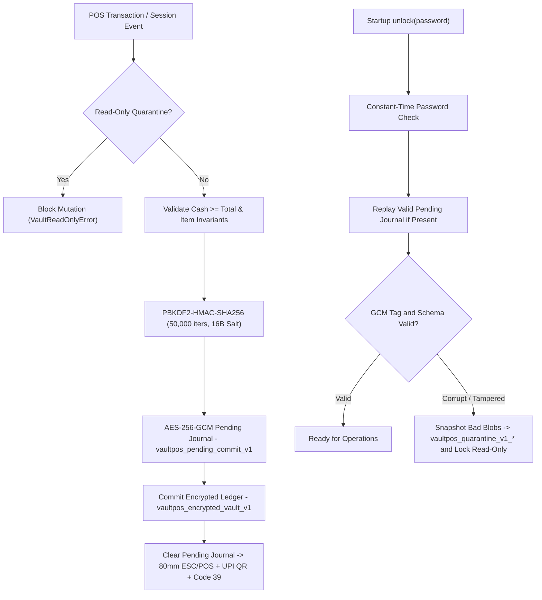

# VaultPOS

[](https://www.python.org/)
[](#security-architecture)
[-1D4ED8)](#security-architecture)
[-16A34A)](#quick-start)

**Offline-first AES-256-GCM encrypted Point-of-Sale (POS) ledger, session timer vault, and 80mm ESC/POS thermal receipt engine.**

VaultPOS is built for environments without reliable internet access. Every ledger write, active play-session timer, and backup export is authenticated and encrypted locally before touching disk, paired with crash-safe write-ahead commit recovery, automatic corruption quarantine with read-only fallback, monthly archiving, dynamic amount-embedded UPI QR strings, and Code 39 thermal receipts.

---

## System & Recovery Architecture



---

## Security Architecture

| Component | Design | Verification / Invariant |
| :--- | :--- | :--- |
| **Key Derivation** | `PBKDF2-HMAC-SHA256`, `50,000` iterations, `16`-byte random salt | Unique salt & 12-byte GCM nonce generated per encryption |
| **Authenticated Encryption** | NIST SP 800-38D `AES-256-GCM` with `hmac.compare_digest` tag check | Slot-key AAD binding prevents cross-slot ciphertext swapping |
| **Owner Credentials** | Salted PBKDF2-SHA256 verification record (`>= 8` char minimum) | No plaintext passwords or hardcoded cryptographic constants |
| **Crash Safety** | Encrypted write-ahead pending slot (`vaultpos_pending_commit_v1`) | Automatically replayed on startup if a commit was interrupted |
| **Corruption Quarantine** | Snapshots damaged blobs under `vaultpos_quarantine_v1_<unix_ms>` | Forces safe read-only fallback until verified `ENC_BACKUP_V2` restore |
| **Thermal Printing** | 72mm / 42-column formatting + raw ESC/POS `GS ( k` QR & `GS k` Code 39 | Zero external runtime or network assets required |

### Local Storage Layout

- `vaultpos_park_config_v2` — Public store settings (`park_name`, `upi_vpa`) + salted PBKDF2-SHA256 auth verifier
- `vaultpos_encrypted_vault_v1` — AES-256-GCM encrypted active receipt ledger
- `vaultpos_live_sessions_v1` — AES-256-GCM encrypted active timed session wristbands
- `vaultpos_pending_commit_v1` — Write-ahead encrypted commit journal for atomic crash recovery
- `vaultpos_receipt_seq_v1` — Daily monotonic sequence counter (`VP-YYMMDD-XXXX`)
- `vaultpos_archive_<YYYY-MM>` — Encrypted monthly ledger partitions
- `vaultpos_quarantine_v1_<unix_ms>` — Immutable forensic quarantine snapshots triggered on integrity failure

---

## Project Layout

```text
VaultPOS/
├── vaultpos/
│   ├── __init__.py     # Public API exports
│   ├── crypto.py       # PBKDF2-HMAC-SHA256 (50k) & NIST SP 800-38D AES-256-GCM
│   ├── vault.py        # VaultStore: crash recovery, quarantine fallback, archiving
│   ├── receipt.py      # Dynamic UPI QR URI, ISO Code 39 encoder, 80mm ESC/POS output
│   └── cli.py          # Standalone terminal CLI
├── tests/
│   └── test_vaultpos.py # KAT vectors, tamper rejection, quarantine & receipt tests
├── pyproject.toml
└── .github/workflows/ci.yml
```

---

## Quick Start

Requires **Python 3.10+** (uses only the Python standard library; automatically uses `cryptography` C-extensions if installed).

```bash
# Run the complete unit test suite
python3 -m unittest discover -s tests -v

# Initialize a local encrypted POS vault
python3 -m vaultpos.cli --store pos_store.json init --park-name "Summit Arcade" --upi-vpa "desk@okicici"

# Record a transaction and print an 80mm thermal receipt with dynamic UPI QR + Code 39
python3 -m vaultpos.cli --store pos_store.json sale --item "All-Day Pass" --qty 2 --price 250.00 --mode CASH --tendered 600.00

# Archive a closed month's ledger & export an encrypted ENC_BACKUP_V2 snapshot
python3 -m vaultpos.cli --store pos_store.json archive 2026-10
python3 -m vaultpos.cli --store pos_store.json backup vaultpos_backup.json
```
