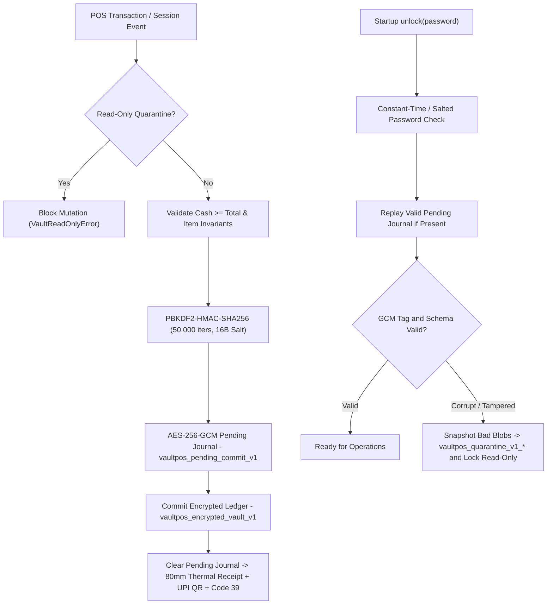

# VaultPOS

[](#use-the-standalone-pos-app)
[](#security-architecture)
[-1D4ED8)](#security-architecture)
[](#production-impact)

**Offline-first AES-256-GCM encrypted Point-of-Sale (POS) application, session timer vault, and 80mm thermal receipt engine.**

---

## Production Impact

Built and deployed for a relative's commercial business to replace fragile manual billing with an air-gapped, tamper-evident point-of-sale counter system. In live production operation, VaultPOS recorded **₹10L+ (>₹1,000,000) in counter transactions in under a month**, operating continuously across shift changes, unstable connectivity, and silent 80mm thermal receipt printing on TVS RP 3200 Lite hardware.

---

## System & Recovery Architecture



---

## Components

### 1. Standalone Browser POS App (`VaultPOS_POS.html` + `Start_VaultPOS_POS.bat`)

A zero-dependency, single-file production POS application designed to run directly from `file://` without any server or internet connection:

- **Counter Payment Modes:**
  - **Cash:** interactive cash-received / change-to-return calculator (`Exact`, `+100`, `+200`, `+500`, `+2000`) with strict under-tender rejection.
  - **UPI on Desk:** fast receipt logging for customers scanning a physical counter UPI standee / soundbox.
  - **Print UPI QR:** ISO/IEC 18004 Byte-mode QR code generator built from scratch in-app (versions v1–v10, Reed-Solomon ECC-L, mask evaluation) rendering dynamic amount-embedded `upi://pay?...` QR codes directly on the 80mm thermal receipt alongside a Code 39 (`*VP-1001*`) receipt barcode.
- **Windows Silent Kiosk Printing (`Start_VaultPOS_POS.bat`):** Launches Microsoft Edge in `--app` + `--kiosk-printing` mode for 1-click printing on 80mm thermal roll printers (`TVS RP 3200 Lite` / `POS-80`, `72mm` printable width, `0mm` margins). Keep only one active `VaultPOS_POS.html` copy per browser profile so `file://` storage stays unified.
- **Session Timers & Extensions:** Live session cards with countdown timers, alert chimes, `+15m` / `+30m` extension billing slips (`#VP-1001-EXT`), void/reissue ledger auditability, optional GST modes (`none`, `inclusive`, `exclusive`), and 04:00 AM business-day cutoffs.
- **Owner Reports & Encrypted Backups:** Printable A4 HTML, Excel (`.xls`), CSV exports, and portable `ENC_BACKUP_V2` AES-256-GCM encrypted snapshots.

### 2. Python Cryptographic Vault & CLI (`vaultpos/`)

Companion zero-dependency Python 3.10+ implementation mirroring the storage, encryption, crash-recovery, quarantine, and ESC/POS receipt logic for server-side auditing, verification, and scripted vault workflows (`vaultpos/crypto.py`, `vaultpos/vault.py`, `vaultpos/receipt.py`, `vaultpos/cli.py`).

---

## Security Architecture

| Component | Design | Verification / Invariant |
| :--- | :--- | :--- |
| **Key Derivation** | `PBKDF2-HMAC-SHA256`, `50,000` iterations, `16`-byte random salt | Unique salt & 12-byte GCM nonce generated per encryption |
| **Authenticated Encryption** | NIST SP 800-38D `AES-256-GCM` with integrity checks | Slot-key / schema binding prevents tampering or cross-slot swapping |
| **Owner Credentials** | Salted PBKDF2-SHA256 verification record (`>= 8` char minimum) | Password rotation re-encrypts active vault, sessions, archives & sequence |
| **Crash Safety** | Encrypted write-ahead pending slot (`vaultpos_pending_commit_v1`) | Automatically replayed on startup if a power cut interrupts a commit |
| **Corruption Quarantine** | Snapshots damaged blobs under `vaultpos_quarantine_v1_*` | Forces read-only mode so corrupt ciphertext is never overwritten |
| **Local Storage Keys** | `vaultpos_encrypted_vault_v1`, `vaultpos_live_sessions_v1`, `vaultpos_park_config_v2`, `vaultpos_receipt_seq_v1`, `vaultpos_archive_v1_*` | Zero plaintext customer PII persisted at rest |

---

## Project Layout

```text
VaultPOS/
├── VaultPOS_POS.html                # Single-file standalone offline POS runtime
├── Start_VaultPOS_POS.bat           # Windows Edge --kiosk-printing launcher
├── vaultpos/                        # Companion zero-dependency Python vault & CLI package
│   ├── __init__.py
│   ├── crypto.py                    # PBKDF2-HMAC-SHA256 (50k) & AES-256-GCM
│   ├── vault.py                     # Crash recovery, quarantine fallback, monthly archiving
│   ├── receipt.py                   # UPI QR URI, Code 39 encoder, 80mm ESC/POS bytes
│   └── cli.py
├── tests/
│   ├── pos-static.test.mjs          # 18 Node tests: HTML/DOM, strict QR ISO/IEC 18004, jsQR, Code 39, vault invariants
│   ├── test_vaultpos.py             # 10 Python tests: NIST GCM KATs, tamper, quarantine, CLI
│   └── fixtures/
│       └── qr-reference-matrices.json
├── tools/
│   ├── lint.mjs                     # Static ID/action/hygiene linter
│   ├── build-release.mjs            # Deterministic offline ZIP + bundle builder
│   └── serve.mjs                    # Local dev preview server with path denylist
├── package.json
├── pyproject.toml
└── VERSION.txt
```

---

## Quick Start & Tests

### Run the Offline Browser App
1. Open `VaultPOS_POS.html` directly in Chrome or Microsoft Edge (macOS/Linux/Windows).
2. On Windows with an 80mm thermal printer set as default, double-click `Start_VaultPOS_POS.bat` for silent kiosk printing.

### Run Verification Suites
```bash
# 1. Node lint & static POS suite (requires Node >= 20)
npm ci
npm run check

# 2. Python cryptographic & CLI suite (requires Python >= 3.10)
python3 -m unittest discover -s tests -v
python3 -m compileall -q vaultpos tests
```

### Python CLI Usage
```bash
python3 -m vaultpos.cli --store pos_store.json init --park-name "Summit Arcade" --upi-vpa "desk@okicici"
python3 -m vaultpos.cli --store pos_store.json sale --item "All-Day Pass" --qty 2 --price 250.00 --mode CASH --tendered 600.00
python3 -m vaultpos.cli --store pos_store.json archive 2026-10
python3 -m vaultpos.cli --store pos_store.json backup vaultpos_backup.json
```
